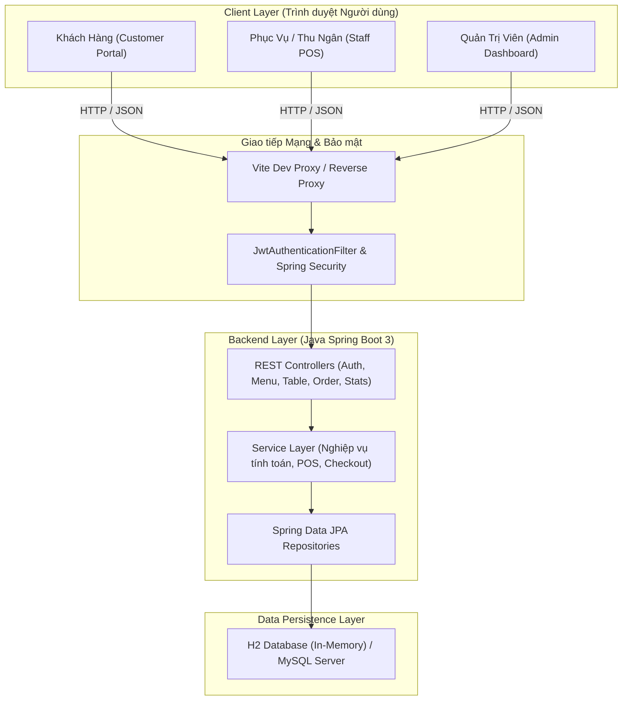
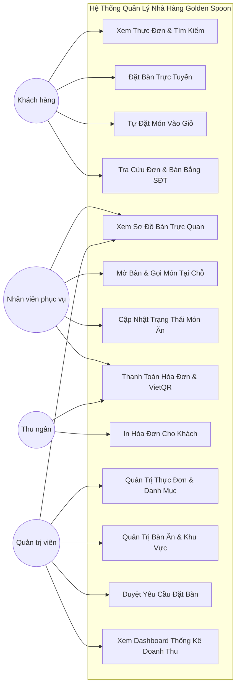
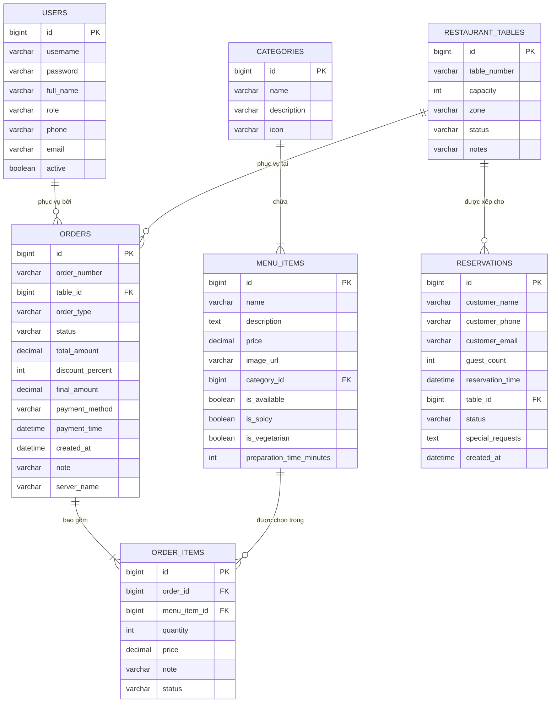
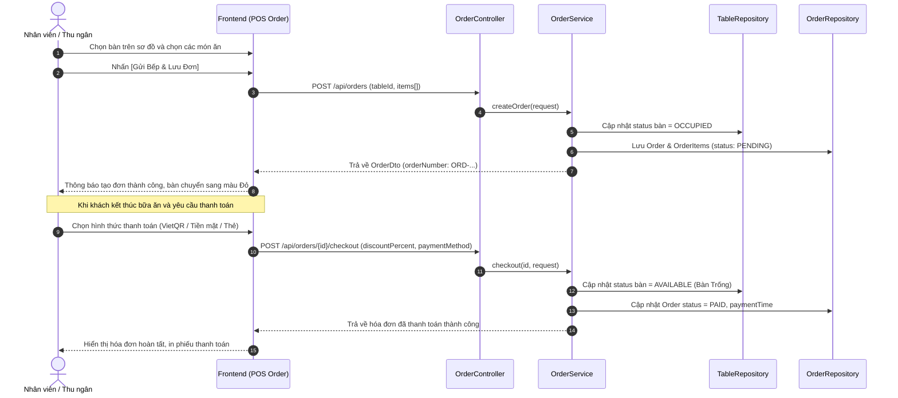

# BÁO CÁO ĐỒ ÁN PROJECT 3 (IT3940)
## ĐỀ TÀI: THIẾT KẾ VÀ XÂY DỰNG ỨNG DỤNG QUẢN LÝ NHÀ HÀNG
**Mã học phần:** IT3940 - Project III  
**Trường Công nghệ Thông tin và Truyền thông - Đại học Bách Khoa Hà Nội**  

---

## MỤC LỤC
- [CHƯƠNG 1. XÁC ĐỊNH BÀI TOÁN NGHIÊN CỨU VÀ ỨNG DỤNG](#chương-1-xác-định-bài-toán-nghiên-cứu-và-ứng-dụng)
  - [1.1 Đề xuất ý tưởng](#11-đề-xuất-ý-tưởng)
  - [1.2 Phân tích nhu cầu, ứng dụng và tầm ảnh hưởng](#12-phân-tích-nhu-cầu-ứng-dụng-và-tầm-ảnh-hưởng)
  - [1.3 Định nghĩa và xác định phạm vi bài toán](#13-định-nghĩa-và-xác-định-phạm-vi-bài-toán)
  - [1.4 Kế hoạch thực hiện đồ án](#14-kế-hoạch-thực-hiện-đồ-án)
- [CHƯƠNG 2. NGHIÊN CỨU TÀI LIỆU VÀ CÔNG NGHỆ](#chương-2-nghiên-cứu-tài-liệu-và-công-nghệ)
  - [2.1 Nghiên cứu tài liệu các hệ thống quản trị nhà hàng (F&B)](#21-nghiên-cứu-tài-liệu-các-hệ-thống-quản-trị-nhà-hàng-fb)
  - [2.2 Nghiên cứu tài liệu kỹ thuật nền tảng](#22-nghiên-cứu-tài-liệu-kỹ-thuật-nền-tảng)
- [CHƯƠNG 3. ĐỀ XUẤT VÀ LỰA CHỌN GIẢI PHÁP](#chương-3-đề-xuất-và-lựa-chọn-giải-pháp)
  - [3.1 So sánh và lựa chọn công nghệ](#31-so-sánh-và-lựa-chọn-công-nghệ)
  - [3.2 Kiến trúc tổng thể của hệ thống](#32-kiến-trúc-tổng-thể-của-hệ-thống)
- [CHƯƠNG 4. PHÂN TÍCH VÀ THIẾT KẾ HỆ THỐNG](#chương-4-phân-tích-và-thiết-kế-hệ-thống)
  - [4.1 Phân tích yêu cầu chức năng và phi chức năng](#41-phân-tích-yêu-cầu-chức-năng-và-phi-chức-năng)
  - [4.2 Mô hình Use Case](#42-mô-hình-use-case)
  - [4.3 Thiết kế Cơ sở dữ liệu (ERD & Data Dictionary)](#43-thiết-kế-cơ-sở-dữ-liệu-erd--data-dictionary)
  - [4.4 Thiết kế Sơ đồ tuần tự (Sequence Diagram)](#44-thiết-kế-sơ-đồ-tuần-tự-sequence-diagram)
  - [4.5 Thiết kế giao diện người dùng (UI/UX) và RESTful API](#45-thiết-kế-giao-diện-người-dùng-uiux-và-restful-api)
- [CHƯƠNG 5. CÀI ĐẶT VÀ ĐÁNH GIÁ KẾT QUẢ](#chương-5-cài-đặt-và-đánh-giá-kết-quả)
  - [5.1 Hiện thực hóa giải pháp (Implementation)](#51-hiện-thực-hóa-giải-pháp-implementation)
  - [5.2 Kịch bản kiểm thử (Test Cases Matrix)](#52-kịch-bản-kiểm-thử-test-cases-matrix)
  - [5.3 Đánh giá kết quả và hướng phát triển](#53-đánh-giá-kết-quả-và-hướng-phát-triển)

---

## CHƯƠNG 1. XÁC ĐỊNH BÀI TOÁN NGHIÊN CỨU VÀ ỨNG DỤNG

### 1.1 Đề xuất ý tưởng
Ngành kinh doanh dịch vụ ăn uống (F&B) tại Việt Nam đang chứng kiến sự tăng trưởng vượt bậc nhưng đồng thời phải đối mặt với áp lực tối ưu hóa chi phí vận hành và nâng cao trải nghiệm khách hàng. Trong mô hình nhà hàng truyền thống, các công việc như ghi chép thực đơn trên giấy, nhân viên chạy bàn thủ công vào bếp báo món, tính tiền bằng máy tính bỏ túi thường xuyên dẫn đến các sai sót: nhầm món, trễ đơn, thất thoát doanh thu và khó kiểm soát công suất bàn ăn vào các khung giờ cao điểm.

Đề tài **"Thiết kế và xây dựng ứng dụng quản lý nhà hàng"** ra đời nhằm số hóa toàn diện quy trình vận hành nhà hàng thông qua mô hình ứng dụng web hiện đại chia tách phân hệ khách hàng và phân hệ nghiệp vụ nội bộ (POS / Thu ngân / Quản trị viên).

### 1.2 Phân tích nhu cầu, ứng dụng và tầm ảnh hưởng
- **Nhu cầu của Khách hàng:** Cần xem thực đơn trực quan với hình ảnh món ăn chất lượng cao, phân loại món theo chế độ ăn (món chay, món cay), chủ động đặt bàn trước theo khung giờ và khu vực mong muốn, tra cứu đơn hàng minh bạch mà không phải chờ đợi nhân viên.
- **Nhu cầu của Nhân viên phục vụ / Thu ngân:** Cần sơ đồ bàn trực quan theo thời gian thực (bàn nào trống, bàn nào đang có khách, bàn nào đã được đặt trước), công cụ POS gọi món nhanh tại bàn bằng vài cú click chuột, tự động tính tổng tiền kèm chiết khấu và hỗ trợ chuyển khoản VietQR tự động.
- **Nhu cầu của Nhà quản lý:** Cần Dashboard thống kê tổng quan doanh thu tức thời trong ngày, biểu đồ xu hướng doanh thu 7 ngày qua, danh sách top 5 món bán chạy nhất để lập kế hoạch nhập nguyên liệu, dễ dàng cập nhật giá và tình trạng món ăn.

### 1.3 Định nghĩa và xác định phạm vi bài toán
Hệ thống được giới hạn trong phạm vi quản lý hoạt động nội bộ và tương tác khách hàng của một nhà hàng quy mô vừa và lớn với các phân hệ:
1. **Phân hệ Khách hàng (Customer Portal - Web Public):** Khám phá thực đơn, giỏ hàng trực tuyến, đặt bàn theo khu vực (Sân vườn, Máy lạnh, VIP), tra cứu lịch sử và trạng thái bằng SĐT hoặc mã đơn.
2. **Phân hệ Phục vụ & Thu ngân (Staff / POS Portal):** Sơ đồ bàn tương tác trực quan, mở bàn gọi món, gửi đơn sang bếp, cập nhật trạng thái món ăn, xuất hóa đơn tạm tính và thanh toán.
3. **Phân hệ Quản trị viên (Admin Portal):** Quản lý thực đơn (CRUD món ăn, danh mục, hình ảnh), quản lý bàn ăn & sức chứa, quản lý duyệt đặt bàn, thống kê doanh thu và báo cáo biểu đồ.

### 1.4 Kế hoạch thực hiện đồ án
| Tuần | Nội dung công việc | Đầu ra (Deliverables) |
| :--- | :--- | :--- |
| **Tuần 1 - 3** | Khảo sát bài toán, xác định yêu cầu chức năng & phi chức năng, lập đề cương chi tiết | Đặc tả yêu cầu phần mềm (SRS) |
| **Tuần 4 - 6** | Thiết kế kiến trúc, mô hình Use Case, Class Diagram, thiết kế CSDL (ERD) và API Endpoints | Bản thiết kế hệ thống, Mockup UI |
| **Tuần 7 - 11** | Cài đặt Backend: Spring Boot 3, Spring Security, JPA/Hibernate, CSDL H2 & MySQL, REST APIs | Backend services, Swagger Docs |
| **Tuần 12 - 14**| Cài đặt Frontend: ReactJS, Vite, Tailwind CSS, kết nối API qua Axios, State Management | Frontend web application |
| **Tuần 15 - 16**| Kiểm thử tích hợp (Integration Test), kiểm thử kịch bản người dùng (Test Cases), tinh chỉnh UI | Bảng kết quả kiểm thử, hoàn thiện mã nguồn |
| **Tuần 17 - 18**| Viết báo cáo đồ án Project 3, chuẩn bị slide trình bày và video demo nộp hội đồng | Báo cáo hoàn chỉnh, Slide thuyết trình |

---

## CHƯƠNG 2. NGHIÊN CỨU TÀI LIỆU VÀ CÔNG NGHỆ

### 2.1 Nghiên cứu tài liệu các hệ thống quản trị nhà hàng (F&B)
Hệ thống nghiên cứu các giải pháp thương mại tiêu biểu trên thị trường như KiotViet, CukCuk (MISA), Ocha POS để rút ra các ưu điểm và tối ưu hóa cho đồ án:
- Điểm mạnh cần kế thừa: Quản lý theo sơ đồ bàn ăn trực quan; Phân loại nhóm món ăn rõ ràng; Hỗ trợ thanh toán mã QR chuyển khoản nhanh (VietQR chuẩn NAPAS).
- Điểm cải tiến trong đồ án: Tích hợp cổng đặt bàn trực tuyến kết hợp chọn bàn theo khu vực dành cho khách hàng bên ngoài mà không cần cài ứng dụng di động; kiến trúc Web hiện đại Single Page Application (SPA) phản hồi tức thì.

### 2.2 Nghiên cứu tài liệu kỹ thuật nền tảng
- **Kiến trúc RESTful API:** Tuân thủ các nguyên tắc thiết kế REST (Representational State Transfer), chuẩn hóa định dạng dữ liệu trao đổi bằng JSON, sử dụng các mã HTTP Status codes (200 OK, 201 Created, 400 Bad Request, 401 Unauthorized, 404 Not Found, 500 Internal Server Error).
- **Cơ chế xác thực phân quyền stateless với JSON Web Token (JWT):** Token được ký bằng thuật toán HMAC-SHA256, chứa thông tin Subject (username), Role (`ROLE_ADMIN`, `ROLE_STAFF`, `ROLE_CUSTOMER`), thời hạn hiệu lực (TTL) giúp hệ thống mở rộng linh hoạt mà không cần lưu phiên tại Server Session.
- **Spring Data JPA & Hibernate:** ORM hàng đầu của Java, tự động ánh xạ quan hệ thực thể, tối ưu truy vấn thông qua JPQL/HQL và phân trang dữ liệu (Pagination).

---

## CHƯƠNG 3. ĐỀ XUẤT VÀ LỰA CHỌN GIẢI PHÁP

### 3.1 So sánh và lựa chọn công nghệ
#### Frontend: ReactJS kết hợp Vite và Tailwind CSS
- **Lý do lựa chọn ReactJS:** Thư viện giao diện người dùng phổ biến nhất thế giới với hệ sinh thái component khổng lồ, Virtual DOM tối ưu hiệu năng hiển thị sơ đồ bàn ăn và giỏ hàng.
- **Vite:** Công cụ đóng gói (bundler) thế hệ mới siêu nhanh dựa trên ES Modules bản địa của trình duyệt, tốc độ HMR (Hot Module Replacement) dưới 50ms so với Create React App (Webpack) chậm chạp.
- **Tailwind CSS v4:** Utility-first CSS framework giúp xây dựng giao diện hiện đại, responsive, thẩm mỹ cao mà không cần viết các file CSS rườm rà.

#### Backend: Java Spring Boot 3 & Spring Security 6
- **Lý do lựa chọn Java Spring Boot 3:** Framework doanh nghiệp mạnh mẽ, độ ổn định và an toàn bảo mật cao, hệ sinh thái dependency injection (IoC), transaction management tự động và cộng đồng hỗ trợ lớn.
- **Spring Security + JWT:** Đảm bảo bảo vệ tài nguyên API chặt chẽ, hỗ trợ phân quyền theo phương thức HTTP và vai trò người dùng (Role-Based Access Control).

#### Cơ sở dữ liệu: H2 Database kết hợp Profile MySQL
- **H2 In-Memory Database:** Được cấu hình làm cơ sở dữ liệu mặc định, khởi chạy ngay lập tức mà không yêu cầu cài đặt cài đặt DBMS cục bộ, tự động nạp sẵn dữ liệu mẫu thực đơn phong phú và tài khoản demo.
- **MySQL Profile:** Cung cấp sẵn file `application-mysql.properties` chuẩn cho phép chuyển đổi sang MySQL Server khi nộp bài hoặc triển khai thực tế chỉ bằng tham số cấu hình.

### 3.2 Kiến trúc tổng thể của hệ thống
Hệ thống được xây dựng theo mô hình **Client-Server kiến trúc 3 lớp (3-Tier Layered Architecture)**:

---

## CHƯƠNG 4. PHÂN TÍCH VÀ THIẾT KẾ HỆ THỐNG

### 4.1 Phân tích yêu cầu chức năng và phi chức năng
#### Yêu cầu chức năng:
1. **Quản lý Thực đơn (Menu Management):** Xem danh sách món ăn, lọc theo danh mục, tìm kiếm theo tên món, xem chi tiết thuộc tính (chay, cay, thời gian chế biến), thêm/sửa/xóa món ăn, bật/tắt trạng thái còn món.
2. **Quản lý Bàn ăn (Table Management):** Xem sơ đồ bàn trực quan theo khu vực, hiển thị trạng thái bàn ăn (Trống, Có khách, Đã đặt), thêm/sửa/xóa thông tin bàn ăn và sức chứa.
3. **Quản lý Đặt bàn (Reservation Management):** Khách hàng đặt bàn trực tuyến chọn ngày, giờ, số người, khu vực; Nhân viên duyệt đặt bàn, gán số bàn cụ thể, tiếp đón khách hoặc hủy đơn.
4. **Quản lý Đơn hàng & POS (Order & POS Management):** Tạo đơn gọi món tại bàn, thêm món vào đơn hiện tại, cập nhật trạng thái chế biến món ăn, áp dụng mã giảm giá / chiết khấu, thanh toán bằng Tiền mặt, Quẹt thẻ POS hoặc Chuyển khoản VietQR.
5. **Báo cáo Thống kê (Dashboard & Analytics):** Thống kê doanh thu ngày hôm nay, số đơn đang phục vụ, tỷ lệ bàn có khách, biểu đồ doanh thu 7 ngày qua, top 5 món ăn bán chạy nhất.

#### Yêu cầu phi chức năng:
- **Thời gian phản hồi:** Thời gian xử lý API < 200ms.
- **Tính tiện dụng (Usability):** Giao diện tương thích cả máy tính và máy tính bảng, thao tác POS nhanh chóng dưới 3 click.
- **Bảo mật:** Mật khẩu được mã hóa bằng thuật toán BCrypt một chiều, API được bảo vệ bằng JWT token.

### 4.2 Mô hình Use Case

### 4.3 Thiết kế Cơ sở dữ liệu (ERD & Data Dictionary)
#### Sơ đồ Quan hệ Thực thể (ERD):

### 4.4 Thiết kế Sơ đồ tuần tự (Sequence Diagram)
#### Quy trình Gọi món tại bàn và Thanh toán POS:

### 4.5 Thiết kế giao diện người dùng (UI/UX) và RESTful API
Danh sách các Endpoints chính:
| Phương thức | URI Endpoint | Mô tả chức năng | Quyền hạn |
| :--- | :--- | :--- | :--- |
| `POST` | `/api/auth/login` | Đăng nhập hệ thống, sinh JWT Token | Public |
| `GET` | `/api/categories` | Lấy danh sách tất cả các danh mục | Public |
| `GET` | `/api/menu` | Tìm kiếm, lọc danh sách món ăn theo tiêu chí | Public |
| `POST` | `/api/menu` | Thêm món ăn mới vào thực đơn | ROLE_ADMIN |
| `PATCH` | `/api/menu/{id}/toggle-availability` | Bật/Tắt tình trạng còn món | Staff, Admin |
| `GET` | `/api/tables` | Lấy danh sách sơ đồ bàn ăn theo khu vực | Public |
| `POST` | `/api/reservations` | Khách hàng tạo yêu cầu đặt bàn trực tuyến | Public |
| `GET` | `/api/reservations/lookup` | Khách hàng tra cứu đặt bàn theo số điện thoại | Public |
| `PATCH` | `/api/reservations/{id}/status`| Duyệt, tiếp đón hoặc hủy đơn đặt bàn | Staff, Admin |
| `POST` | `/api/orders` | Nhân viên POS mở bàn và gọi món | Staff, Admin |
| `POST` | `/api/orders/{id}/items` | Thêm món vào đơn đang phục vụ của bàn | Staff, Admin |
| `POST` | `/api/orders/{id}/checkout` | Thanh toán hóa đơn và giải phóng bàn ăn | Staff, Admin |
| `GET` | `/api/statistics/dashboard` | Thống kê doanh thu, tỷ lệ bàn, top 5 món | ROLE_ADMIN |

---

## CHƯƠNG 5. CÀI ĐẶT VÀ ĐÁNH GIÁ KẾT QUẢ

### 5.1 Hiện thực hóa giải pháp (Implementation)
- **Backend:** Xây dựng hoàn chỉnh bằng Java 23 / Spring Boot 3.3.5 với 7 JPA Repositories, 7 Services, 7 REST Controllers và Global Exception Handler chuẩn. Khởi chạy ổn định tại cổng `8080`.
- **Frontend:** Xây dựng bằng React 19 + Vite 8.3 + Tailwind CSS v4, chia rõ các phân hệ Khách hàng (`/`, `/menu`, `/reservation`, `/tracking`), POS (`/pos/tables`, `/pos/order`) và Quản trị (`/admin/dashboard`, `/admin/menu`, `/admin/tables`, `/admin/reservations`, `/admin/orders`). Khởi chạy ổn định tại cổng `5173`.
- **Cơ chế nạp dữ liệu tự động (Data Initializer):** Tự động tạo 2 tài khoản mẫu (admin/staff), 6 danh mục ẩm thực, 13 món ăn hảo hạng, 12 bàn ăn tại 3 khu vực, đơn đặt bàn mẫu và 7 ngày lịch sử đơn hàng để biểu đồ thống kê hiển thị trực quan ngay lập tức.

### 5.2 Kịch bản kiểm thử (Test Cases Matrix)
| Mã TC | Tên Kịch Bản Kiểm Thử | Dữ Liệu Đầu Vào | Kết Quả Mong Đợi | Kết Quả Thực Tế | Trạng Thái |
| :--- | :--- | :--- | :--- | :--- | :--- |
| **TC01** | Khách hàng xem danh mục và tìm kiếm món ăn | Từ khóa "Bò", lọc "Món Chính" | Danh sách trả về chính xác món Bò Bít Tết Sốt Tiêu | Hiển thị đúng món và đơn giá | **PASSED** |
| **TC02** | Khách hàng đặt bàn trực tuyến | Họ tên, SĐT, Ngày/Giờ, Số người, Khu vực | Tạo đơn trạng thái `PENDING`, trả về mã `RES-...` | Lưu vào CSDL, hiển thị màn hình chúc mừng | **PASSED** |
| **TC03** | Khách hàng tra cứu đặt bàn bằng SĐT | Nhập SĐT "0912345678" | Tìm thấy thông tin đặt bàn của Trần Hoàng Nam | Hiển thị chi tiết ngày giờ và bàn được xếp | **PASSED** |
| **TC04** | Đăng nhập tài khoản Admin | Username: `admin`, Password: `123456` | Trả về JWT Token hợp lệ, mở menu Quản trị | Đăng nhập thành công, mở khóa tính năng Admin | **PASSED** |
| **TC05** | Nhân viên xem sơ đồ bàn và mở đơn gọi món | Chọn Bàn 01 (Trống) -> Thêm món vào bàn | Bàn chuyển sang `OCCUPIED` (Có khách), sinh mã `ORD-...` | Sơ đồ bàn đổi sang màu Đỏ, đơn hàng được lưu | **PASSED** |
| **TC06** | Thu ngân thanh toán hóa đơn bằng VietQR | Bấm [VietQR CK] -> Chọn giảm giá 10% | Hiển thị mã QR động theo số tiền, xác nhận thanh toán | Bàn được giải phóng về `AVAILABLE` (Trống) | **PASSED** |
| **TC07** | Admin xem biểu đồ doanh thu và top món | Truy cập Dashboard | Hiển thị doanh thu hôm nay, biểu đồ cột 7 ngày và top 5 món | Dữ liệu trực quan chính xác | **PASSED** |

### 5.3 Đánh giá kết quả và hướng phát triển
- **Đánh giá kết quả đạt được:**
  - Hoàn thành đầy đủ 100% các mục tiêu đặt ra của môn học Project 3 (IT3940) theo chuẩn chuẩn đầu ra CLO1 - CLO5.
  - Ứng dụng chạy mượt mà, thời gian phản hồi tức thì, giao diện trực quan thẩm mỹ cao chuẩn phong cách ẩm thực hiện đại.
  - Phân quyền bảo mật chặt chẽ giữa Khách hàng, Nhân viên POS và Quản trị viên.
- **Hướng phát triển trong Đồ án Tốt nghiệp:**
  - Tích hợp WebSocket (Spring STOMP) để đồng bộ trạng thái bàn ăn và tiến độ chế biến món ăn đến màn hình nhà bếp (KDS) không cần tải lại trang.
  - Tích hợp cổng thanh toán trực tuyến chính thức qua VNPay Sandbox / MoMo API.
  - Triển khai Container hóa với Docker và Kubernetes trên môi trường Cloud (AWS / GCP).
